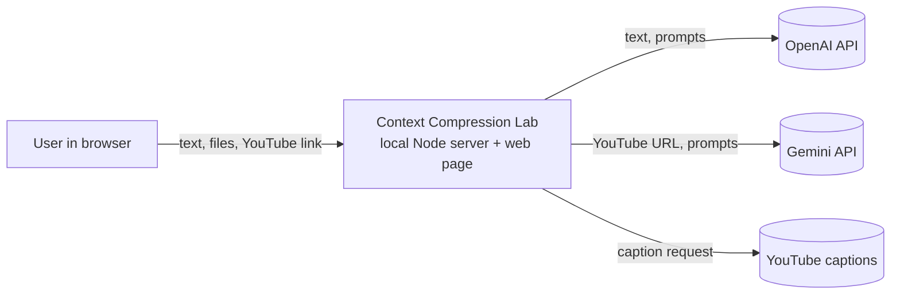
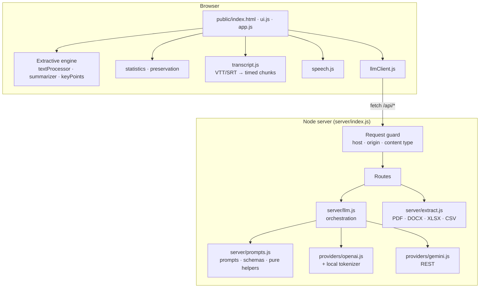
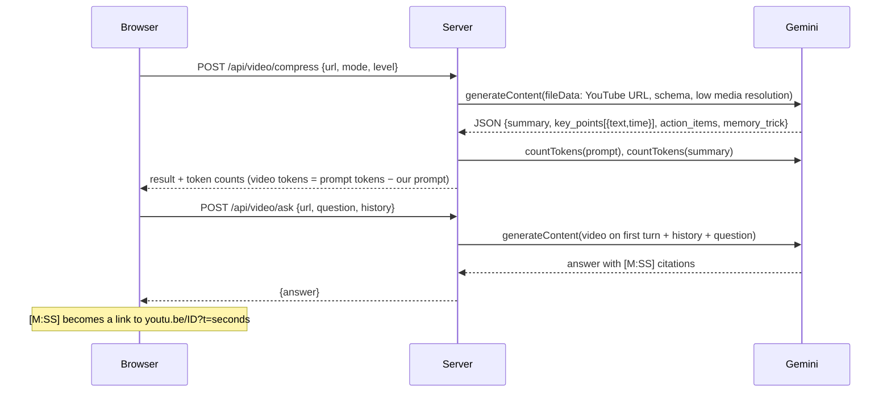
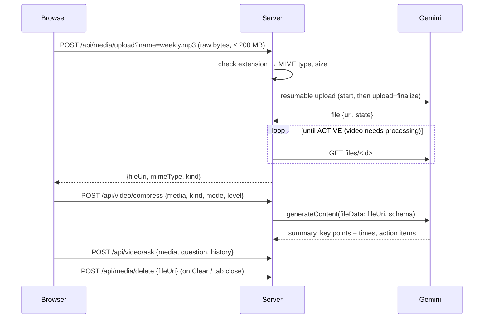
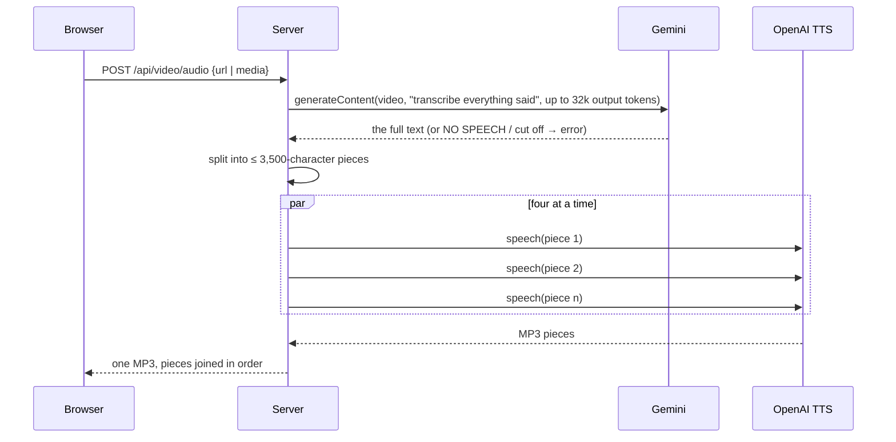

# Architecture

Describes *how* the system satisfies [REQUIREMENTS.md](REQUIREMENTS.md). Decisions and their reasons are recorded as [ADRs](adr/).

## 1. Context

The system runs on the user's machine. The only external parties are the model providers and YouTube, and each receives data only when the user selects a feature that needs it.

## 2. Components

| Layer | Responsibility | Never does |
|---|---|---|
| **Browser** | UI, offline engine, subtitle parsing, read-aloud, metrics display. | Hold an API key; call a provider directly. |
| **Request guard** | Refuse anything not from the local page. | — |
| **Routes** (`server/index.js`) | Validate input, call one function, map errors to HTTP statuses. | Contain prompts or provider details. |
| **`llm.js`** | Combine prompts, providers and result mapping into five operations: `compress`, `evaluate`, `countTokens`, `videoCompress`, `videoAsk`. | Know provider wire formats. |
| **`prompts.js`** | Prompts, JSON schemas, validation and mapping helpers. Pure functions. | Make network calls. |
| **Providers** | One module per vendor: request shape, error translation, retries. Same return shape (`{ data, usage }`). | Contain business rules. |
| **`extract.js`** | Bytes + filename → plain text. | Store files. |

## 3. Key flows

### 3.1 Text compression

1. User pastes text, picks engine and level, presses a button.
2. **Extractive:** the browser ranks sentences (TF-IDF + position), selects the top K in original order, picks diversity-filtered key points.
3. **LLM:** `POST /api/compress` → `llm.compress` builds the system prompt (target length by level, key-point limit by level *and* length) and a strict JSON schema → OpenAI → typed result.
4. Either way, the browser asks `POST /api/tokens` for exact counts (local tokenizer; estimate if the server is down) and computes the metrics.

### 3.2 Transcripts and captions

`.vtt/.srt` are parsed **in the browser** into segments, then grouped into ~8–30-word *chunks* that act as sentences and keep their start time. Captions have no punctuation, so normal sentence splitting would fail. Chunks are numbered (`[12] (3:41) …`) when sent to an LLM; the model returns the **line number** of each point, and the server maps it back to a real timestamp, so the model never invents one.

YouTube captions come from `GET /api/transcript` (browsers cannot fetch them). The package returns milliseconds or seconds depending on the caption format; the server decides the unit from the **median caption duration**, not from the last timestamp (which misreads short videos).

### 3.3 Documents

`POST /api/extract?name=file.ext` receives the raw bytes (max 15 MB) → `extract.js` → text. PDF via `unpdf`, Word via `mammoth`, Excel via `exceljs` (rows rendered as `a | b | c`), CSV via a small parser. The text then enters the normal pipeline (3.1).

### 3.4 Video with Gemini

Model selection (ADR-0004): `GEMINI_MODEL` pins one model and disables the fallback. Otherwise the key's model list is ranked **speed-first** — `gemini-flash-lite-latest`, `gemini-flash-latest`, then `gemini-N-flash-lite` and `gemini-N-flash` by newest N, previews and non-text models excluded — and the top three become candidates. A candidate that answers 404, 429, 500, 503 or times out (150 s) hands over to the next; the one that succeeds is remembered for later calls. Other errors (bad key, private video, safety) are not retried. If a model rejects the response schema or media-resolution setting, the call is retried once in plain JSON mode with the schema moved into the prompt.

### 3.5 LLM evaluation

Three sequential calls to the text provider (see ADR-0005): (1) write questions with gold answers from the **original**; (2) answer them seeing **only the compressed text**; (3) grade, and list unsupported claims. Score = (correct + ½·partial) ÷ questions. Videos are excluded: there is no source text.

### 3.6 Meeting recordings

Zoom and Google Meet recording links are private (login, passcode), so the app cannot fetch them. The user downloads the recording and uploads the file.

The server never stores the file: it is buffered in memory for the upload and dropped. `fileUri` values are only accepted if they point into Gemini's own file store, so the routes cannot be used to make the server fetch arbitrary URLs. Audio uses an "audio recording" prompt (no mention of on-screen content, and "never invent names"); video uses the video prompt.

### 3.7 Audio of a summary

The browser sends the **summary** (or the key points, if no summary was asked for) to `POST /api/tts`. The server splits it at sentence ends into pieces of at most 3,500 characters (the speech API takes 4,096), voices them with OpenAI text-to-speech and returns one `audio/mpeg` response. The page plays it from a `blob:` URL and offers it as a download. A downloaded MP3 keeps playing with the phone locked, which the free in-browser *Listen* button (speech synthesis) does not — that is why both exist.

### 3.8 The whole video as audio

Design points: the text is requested as **plain prose, not JSON** (long JSON strings are fragile); a transcript that hit the model's output limit is **refused**, never turned into a silently shorter audio; speech pieces are voiced in parallel (measured: one 3,500-character piece takes ~30 s) with at most four in flight, and joined by position, so a slow first piece still comes first. The original audio track is never copied — that would mean downloading from YouTube, which its terms forbid.

## 4. Data handling

| Data | Where it goes | Stored? |
|---|---|---|
| Pasted text / extracted document text | Browser → server → OpenAI (only if the LLM engine is chosen) | No |
| Uploaded file bytes | Browser → server memory → parsed → discarded | No |
| YouTube URL and questions | Browser → server → Gemini | No |
| Meeting recording | Browser → server memory → Gemini file store → deleted on Clear / tab close (Google expires it after 48 h regardless) | No (not by this server) |
| Briefing text | Browser → server → OpenAI text-to-speech → MP3 back to the browser | No |
| API keys | Server environment / `.env` (git-ignored) | Only on the user's disk |
| Results | Browser memory | No (lost on reload) |

## 5. Failure behaviour

| Situation | Behaviour |
|---|---|
| No key for a provider | Related option disabled with the reason; routes answer `503` with instructions. |
| Server not running | Offline engine, subtitle/text files and read-aloud still work; token counts fall back to estimates. |
| Provider quota / rate limit | Friendly message (`429`); OpenAI SDK retries transient errors itself. |
| Model refuses or truncates | `422` with a specific message. |
| Model returns invalid JSON | `502`, "unreadable response, please retry". |
| Invalid timestamp from a model | Dropped (no chip shown). |
| Malformed HTTP request | `400`; server keeps running. |

## 6. Technology choices

| Choice | Reason |
|---|---|
| Vanilla JS, no bundler | Zero build step; easy to read and to run. |
| Node `http` (no framework) | Few routes; fewer dependencies to audit. |
| OpenAI SDK; Gemini via `fetch` | Official SDK where the API is stable; REST for Gemini keeps it dependency-free and lets tests redirect the base URL. |
| `node:test` | Built in; no test framework dependency. |
| `gpt-tokenizer` | Exact OpenAI token counts, offline. |

## 7. Known limitations

See README ("Design decisions and limitations") and [SECURITY.md](SECURITY.md). The most important: the Gemini integration has only been exercised against a fake API, and the server has no authentication — it is for local use.
